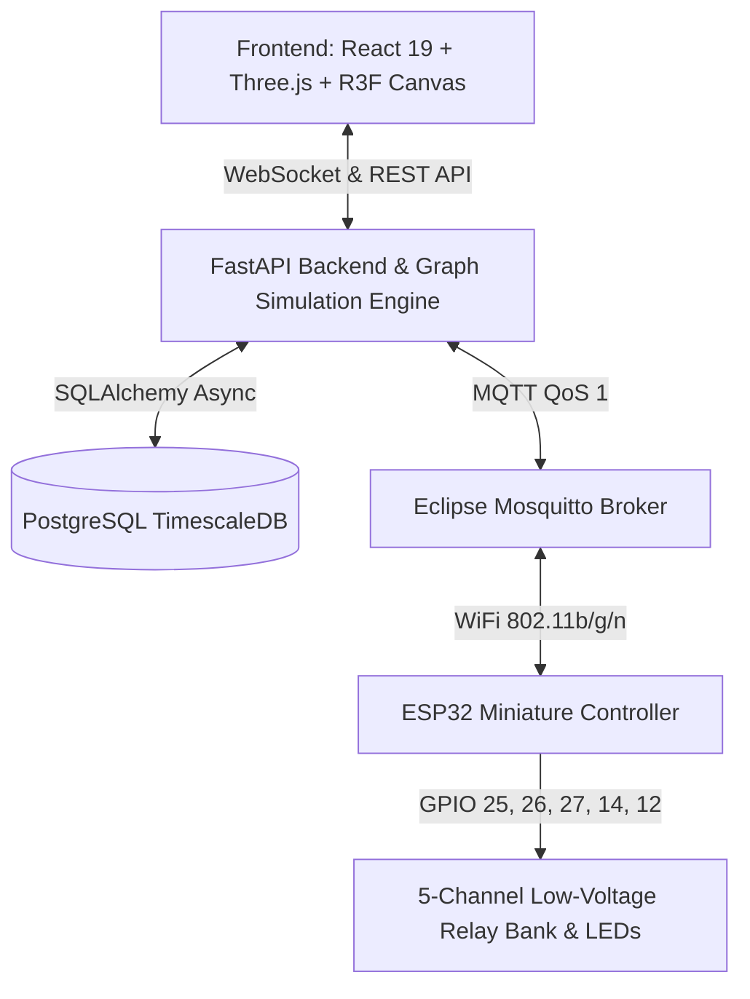

# GRIDTWIN: 3D Electricity Distribution Digital Twin Virtual Laboratory

[](https://fastapi.tiangolo.com)
[](https://react.dev)
[](https://threejs.org)
[](https://www.espressif.com)
[](https://mosquitto.org)
[](https://tailwindcss.com)

**GRIDTWIN** is an industrial-grade full-stack Digital Twin Virtual Laboratory for electric power distribution networks. It bridges real-time 3D simulation with physical miniature bench hardware (ESP32 microcontrollers, optoisolated relay banks, status indicators) via MQTT, WebSockets, and graph-theoretical electrical network solvers.

---

## ⚡ System Architecture



---

## 🏗️ Distribution Network Model (5 Feeder Sections)

| Section | Circuit Breaker / Switch | Nominal Voltage | Consumer Facility | Demand (kW) | ESP32 GPIO | Output Function |
|:---:|:---:|:---:|:---|:---:|:---:|:---|
| **Primary** | **SS-01 Incomer** | 33 kV / 11 kV | 10 MVA Distribution Substation | — | — | Grid Incomer Transformer |
| **T1** | `SW-T1` | 11 kV / 415 V | Maple Crest Residential Quarter | 345.5 kW | GPIO 25 | Relay 1 / Blue Status LED |
| **T2** | `SW-T2` | 11 kV / 415 V | Central Commerce Plaza & Retail | 520.0 kW | GPIO 26 | Relay 2 / Green Status LED |
| **T3** | `SW-T3` | 11 kV / 415 V | Metropolitan Hospital (Critical Facility) | 412.8 kW | GPIO 27 | Relay 3 / Red Emergency Beacon |
| **T4** | `SW-T4` | 11 kV / 415 V | Titan Precision Manufacturing Plant | 685.0 kW | GPIO 14 | Relay 4 / Amber Status LED |
| **T5** | `SW-T5` | 11 kV / 415 V | Helios Solar PV Farm & EV Charging Hub | 210.4 kW | GPIO 12 | Relay 5 / Cyan Status LED |

---

## 🚀 Quick Start Guide

### Option 1: Full Docker Compose Launch (Recommended)

From the project root (`gridtwin`):
```bash
docker-compose up --build -d
```
Services available:
- **Web Digital Twin UI**: [http://localhost:5173](http://localhost:5173)
- **FastAPI OpenAPI Swagger**: [http://localhost:8000/docs](http://localhost:8000/docs)
- **MQTT Broker**: `localhost:1883` (WebSockets on `9001`)
- **PostgreSQL Database**: `localhost:5432`

---

### Option 2: Local Standalone Development

#### 1. Frontend
```bash
cd frontend
npm install
npm run dev
```
Open [http://localhost:5173](http://localhost:5173). The frontend includes a standalone real-time simulation engine that works out-of-the-box even without backend services running!

#### 2. Backend (FastAPI)
```bash
cd backend
python -m venv .venv
# Windows: .venv\Scripts\activate
# Linux/macOS: source .venv/bin/activate
pip install fastapi uvicorn sqlalchemy asyncpg pydantic paho-mqtt websockets
uvicorn app.main:app --reload --port 8000
```

---

## 🔌 ESP32 Hardware Wiring & Pinout Guide

> [!IMPORTANT]
> The bench miniature setup operates strictly at safe low-voltage DC (5V / 3.3V) for laboratory training. Do not connect mains voltages to this miniature board!

```
                  ┌──────────────────────────────┐
                  │      ESP32 DevKit V1         │
                  │                              │
                  │  GPIO 25 ────> [Relay 1 IN]  │ ──> Section T1 (Residential)
                  │  GPIO 26 ────> [Relay 2 IN]  │ ──> Section T2 (Commercial)
                  │  GPIO 27 ────> [Relay 3 IN]  │ ──> Section T3 (Hospital)
                  │  GPIO 14 ────> [Relay 4 IN]  │ ──> Section T4 (Industrial)
                  │  GPIO 12 ────> [Relay 5 IN]  │ ──> Section T5 (Renewable)
                  │                              │
                  │  GND     ────> GND Rail      │
                  │  VIN/5V  ────> VCC (5V Bus)  │
                  └──────────────────────────────┘
```

Firmware can be built and flashed with PlatformIO:
```bash
cd firmware/esp32_gridtwin
pio run -t upload
```

---

## 🧪 Simulation Scenarios Included
- **Nominal Full Grid Operation**: All 5 reclosers closed, balanced 1.0 p.u. voltage, 2173.7 kW served.
- **Section 2 Feeder Ground Fault**: Simulates line trip, automated breaker opening in 40ms.
- **Section 4 Scheduled Maintenance**: De-energizes Industrial plant with armed safety interlocks.
- **Hospital Priority Islanding**: Selective load shedding isolates non-critical feeders 1, 2, and 4 while preserving hospital life-support and solar microgrid.
- **Total Blackout & Restoration Sequence**: Simultaneous tripping of all distribution switches and guided black start.

---

## 📜 License
Developed for engineering laboratory research and electrical distribution digital twin training.
